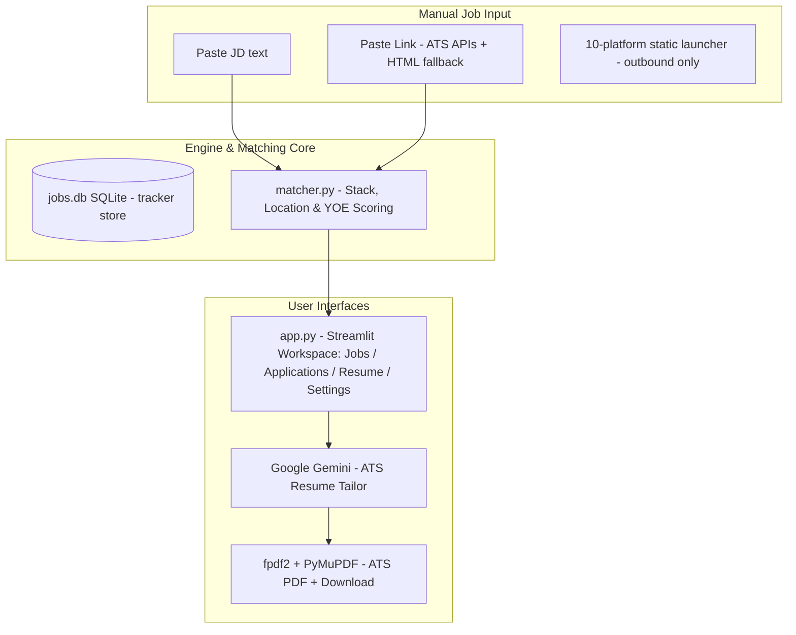

<div align="center">

# ⚡ JOBSCOUT AI • TECH JOB COPILOT
### *Autonomous Tech Job Aggregator • Multi-Factor Match Engine • Gemini-Powered ATS Tailor*

[](https://jobscout-dev.streamlit.app/)
[](https://python.org)
[](https://streamlit.io)
[](https://ai.google.dev/)
[](https://sqlite.org)
[](LICENSE)

<br/>

**Tired of manually tuning your resume for every ATS?**
JobScout AI takes a job description you found on any portal — via pasted text or a job link — scores it with deterministic heuristic filters, and uses Google Gemini to tailor your resume & generate ATS-proof PDFs in seconds.

> **Product note:** multi-platform job aggregation and background scraping were intentionally removed. You discover jobs on the portals directly (Naukri, Indeed, LinkedIn, company career sites), then use **Paste JD** or **Paste Link** in JobTool to tailor and track. The Jobs page is an application workspace, not a job board.

[Live Demo](https://jobscout-dev.streamlit.app/) • [Features](#-core-capabilities) • [Architecture](#-architecture-flow) • [Quick Start](#-quick-start) • [Configuration](#-configuration) • [Security](#-security--privacy-first)

---

</div>

## 💥 Core Capabilities

### 1. 📄 Paste JD / Paste Link Workflow
Bring a job you found on any portal:
- **Paste JD**: paste raw job-description text — Gemini extracts title, company, location, experience, and skills.
- **Paste Link**: import a posting URL (SmartRecruiters, Greenhouse, Lever, Indeed, generic career pages with HTML fallback).
- **10-platform launcher**: static outbound links to browse portals manually — zero scraping, zero background fetching.
- If a URL can't be extracted, the app falls back to manual JD paste. No CAPTCHA/proxy bypass, ever.

### 2. 🎯 Multi-Factor Scoring Engine
No generic keyword searching. Every job is evaluated against your personalized `profile.json`:
- **Stack Score**: Matches backend, frontend, database, and tooling keywords.
- **Experience Sanity Check**: Discards jobs demanding 5–10+ years of seniority if you're early in your career.
- **Commute & Region Routing**: Filters jobs by transit lines (e.g., Western/Central Lines in Mumbai) or fully Remote tags.
- **Relevance Index**: Classifies each opening into **STRONG MATCH**, **POSSIBLE**, or **NOT ELIGIBLE**.

### 3. 🤖 Gemini ATS Resume Tailor & PDF Engine
- **Live JD Breakdown**: Inspects the target job description against your master resume.
- **AI Customization**: Reframes technical summaries and project bullet points with action verbs and target keywords.
- **1-Click PDF Compilation**: Uses `fpdf2` and `PyMuPDF` to export an ultra-clean, machine-readable ATS-compliant PDF.

### 4. 🗂️ Application Workspace & Tracker
- Jobs page answers one question: *"Have you found a job? Let's tailor your resume for it."*
- Quick Actions command bar: **Paste JD** / **Paste Link** / **10 Platforms**.
- Built-in Application Tracker with status states (`Applied`, `Interview`, `Offer`, `Rejected`).

---

## 🏗️ Architecture Flow



---

## ⚡ Quick Start

### 1. Clone & Set Up Environment
```bash
# Clone the repository
git clone https://github.com/PrathameshDev2803/jobscout-ai.git
cd jobscout-ai

# Create virtual environment
python -m venv .venv

# Activate virtual environment
# Windows:
.venv\Scripts\activate
# Linux/macOS:
source .venv/bin/activate

# Install dependencies
pip install -r requirements.txt
```

### 2. Configure Environment (`.env`)
```bash
cp .env.example .env
```
Open `.env` and fill in your keys:
```env
# Gemini API Key (Get free at https://aistudio.google.com/app/apikey)
GEMINI_API_KEY=your_gemini_api_key_here
```

### 3. Launch App
```bash
streamlit run app.py
```
> The app will automatically initialize `profile.json` and `resume.txt` on first launch from safe templates. You can customize them directly in the **Settings** tab.

---

## 📂 Repository Structure

```text
├── app.py                 # Streamlit workspace (Jobs / Applications / Resume / Settings), ATS Tailor & Studio
├── fetch.py               # Tracker store + single-URL job import (Paste Link)
├── matcher.py             # Deterministic scoring (Stack, Location, Seniority)
├── profile.example.json   # Base configuration profile template
├── resume.example.txt     # Clean plain-text master resume template
├── requirements.txt       # Production dependencies
├── .env.example           # Environment template
└── .gitignore             # Airtight protection for PII, keys, and DBs
```

---

## 🛡️ Security & Privacy First

- **Zero PII Exposure**: `profile.json` and `resume.txt` are strictly git-ignored. Your personal identity, contact numbers, and employment history stay safely on your local machine.
- **No Hardcoded Secrets**: All API keys and SMTP credentials load from `.env` or temporary session state.
- **Sanitized Templates**: Cloned instances start with mock profiles that won't break on a fresh clone.

---

## 🤝 Contributing

Contributions, issues, and feature requests are welcome!  
Feel free to check [issues page](https://github.com/PrathameshDev2803/jobscout-ai/issues).

---

## 📄 License

Distributed under the **MIT License**. See `LICENSE` for more information.

<div align="center">
  <sub>Built with ☕, Python, and relentless automation. Star ⭐ this repo if it saved you time!</sub>
</div>
